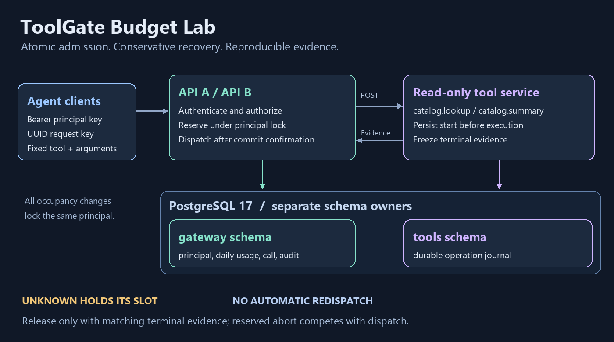
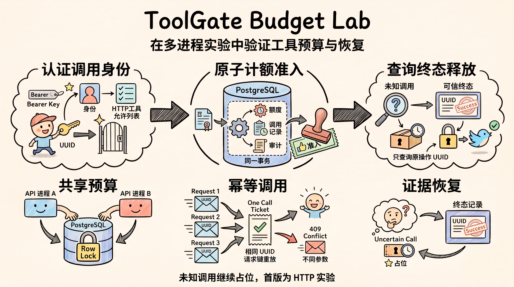

# ToolGate Budget Lab

### Correct tool-call budgets across agent backend processes

**Reproduce quota races and failure recovery with two API processes, real PostgreSQL, and a durable read-only tool service. Check that uncertain calls keep their slots and terminal evidence releases them once.**

English | [中文](README_ZH.md)

[Quick start](#quick-start) · [Run the experiments](#run-the-experiments) · [Protocol](docs/api-and-states.md) · [Acceptance tests](docs/acceptance.md)



*Architecture diagram of the implemented HTTP lab. Each schema has a separate database owner.*



## Features

- **Authenticated budgets:** server-side Bearer keys bind callers to principals and fixed tool allowlists. UTC daily admission limits and held-call concurrency are independent per principal.
- **Atomic admission:** quota updates, call records, and audit events commit together under a principal row lock. Network I/O happens after the transaction.
- **Idempotent requests:** a principal and UUID request key identify one call. Replays do not charge or dispatch again; conflicting payloads return 409.
- **Conservative recovery:** timeouts, handler cancellation, client disconnects, and API crashes keep uncertain occupancy. Recovery queries the original operation UUID and requires matching terminal evidence.
- **Reproducible evidence:** real PostgreSQL and subprocess tests, synchronized races, response truncation, process termination, sanitized raw measurements, and monotonic tool lifecycle observations.

The fixed read-only tools are `catalog.lookup` and `catalog.summary`. No LLM is needed to run the lab.

## Quick start

Requires Docker Engine and Compose. Local bootstrap generates random demo credentials once; existing credentials, volumes, and budgets are preserved.

Windows PowerShell:

```powershell
.\scripts\start.ps1
```

Linux/macOS (Python 3.12+):

```bash
python scripts/bootstrap.py
docker compose up -d --build --wait
```

API A: `http://127.0.0.1:58081` · API B: `http://127.0.0.1:58082` · tool service: `http://127.0.0.1:58083`.

Readiness: `GET /health/ready`. The demo principal `alpha` can use both tools; `beta` can use lookup. Each has a daily limit of 3 and concurrency limit of 2. Keys are in your ignored local `.env`; the sample configuration contains placeholders only.

```http
POST /v1/calls
Authorization: Bearer <ALPHA_KEY>
Idempotency-Key: <new UUID>
Content-Type: application/json

{"tool":"catalog.lookup","arguments":{"sku":"SKU-001"}}
```

A terminal call returns 200. A held, uncertain call returns 202 with an ID and query URL. Query `/v1/calls/{id}` or `/v1/budget` with the same authenticated principal. Daily limits count unique admitted calls; failure or safe abortion does not refund admission.

Stop with `docker compose down` or `.\scripts\stop.ps1`; both retain data. Do not commit `.env`.

## Run the experiments

Requires uv and Python 3.12 (the project pins 3.12.12 for local tests).

```bash
uv sync --frozen
uv run python scripts/bootstrap.py
docker compose up -d --wait postgres
uv run python scripts/run_tests.py
uv run ruff check .
uv run ruff format --check .
uv run python scripts/load_lab.py --requests 100
```

Tests use the separate `toolgate_test` database, random principals, and owned subprocesses. Required database tests fail explicitly if their configuration is missing. Immutable tool evidence stays in the test database; gateway cleanup affects only each experiment's principal.

The load script starts two API processes and one tool process on temporary loopback ports. It runs normal calls, daily quota races, concurrency races, terminal response loss, and an API process kill. It does not consume the development principals' budgets.

Published sample: 64 local tests passed; fresh-volume startup and cross-API replay passed. In the 100-request races, the daily limit of 3 admitted 3 calls, and the concurrency limit of 2 admitted 2 while the tool barrier held. See the [sample report](docs/reports/load-report.md) and [sanitized raw data](artifacts/load-results.json) for the measured environment and timing definitions. These are local correctness experiments, not production throughput claims.

Controlled recovery commands:

```bash
docker compose run --rm api-a reconcile --call-id <CALL_UUID>
docker compose run --rm api-a reconcile --reserved --limit 100
```

The first command only queries the original operation. The second safely aborts expired calls that are still reserved; it cannot reclaim dispatching or unknown calls without evidence.

## Documentation

- [API and states](docs/api-and-states.md)
- [A01–A14 acceptance coverage](docs/acceptance.md)
- [Real process tests and observation boundaries](docs/process-tests.md)
- [Four demo groups and interview walkthrough](docs/demo-and-interview.md)
- [Load report](docs/reports/load-report.md)

Detailed guides currently use Chinese. The GitHub Actions workflow runs database/process tests, lint, and Compose startup; check the repository's Actions tab for the current remote result.

## Guarantee boundary

The lab assumes all tool starts pass through the gateway, one admission starts at most one operation, and the upstream terminal journal is trustworthy. HTTP dispatch requires an acknowledged database commit, with no automatic retry or redirect. Only a matching terminal operation releases a dispatched call; an unclaimed reservation can be aborted under the same lock and state check.

An unknown call may hold its slot indefinitely if the tool cannot supply terminal evidence. This HTTP lab does not claim MCP compatibility, distributed exactly-once execution, arbitrary tool safety, or production deployment readiness. Tools and gateway write separate schemas and communicate through the fixed HTTP protocol.

## License

[MIT](LICENSE), copyright cloudwallker.
