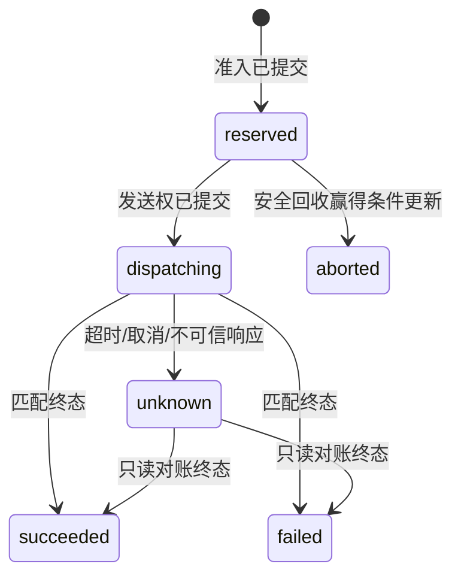

# API 与状态协议

所有业务入口使用服务端配置的 Bearer Key。客户端不能指定 principal/actor，也不能指定工具地址。API 不返回认证头、原始非法参数或数据库异常文本。

| 入口 | 成功响应 |
| --- | --- |
| `POST /v1/calls` | 200 终态，202 仍持位；必须带 UUID Idempotency-Key |
| `GET /v1/calls/{UUID}` | 仅返回当前身份可见调用；不触发工具执行 |
| `GET /v1/budget` | UTC 当日使用量、剩余量及跨日 inflight |
| `GET /health/live` | API 存活 |
| `GET /health/ready` | 能读取网关 schema |

调用体严格限定为 `{"tool":"catalog.lookup|catalog.summary","arguments":{"sku":"..."}}`，sku 为 1～64 字符且含非空白字符。结果包括 `id/tool/state/slot_held/result/query_url`。

| 错误 | HTTP 状态 |
| --- | --- |
| AUTH_DENIED | 401 |
| TOOL_DENIED / PRINCIPAL_DISABLED | 403 |
| CALL_NOT_FOUND | 404 |
| IDEMPOTENCY_CONFLICT | 409 |
| INVALID_REQUEST | 422 |
| DAILY_BUDGET_EXHAUSTED / CONCURRENCY_EXHAUSTED | 429 |
| PERSISTENCE_UNAVAILABLE | 503 |

拒绝不扣日额，不创建可执行调用。认证、输入和授权拒绝在数据库正常时写审计；审计不能持久化时不放行。503 可能发生于提交确认丢失，不能据此断言事务回滚。使用原请求键重放/查询；重放永不重新发送。



`reserved/dispatching/running/unknown` 都持有名额；`succeeded/failed/aborted` 均不持位。当前实现对已发送调用保留 dispatching，再在不确定响应时转 unknown；running 是工具侧已开始证据，网关状态定义保留该值。

正常工具 HTTP 200 本身不是证据；必须是匹配 operation UUID 的合法 schema。HTTP 404/500、running、非法证据、断连、取消和 API 被杀均不释放。未知状态可以长期持位。

受控命令（Compose 中借用 API 环境）：

```bash
docker compose run --rm api-a reconcile --call-id <CALL_UUID>
docker compose run --rm api-a reconcile --reserved --limit 100
```

第一条只 GET 原 operation，不重发；第二条只回收过期且仍 reserved 的调用，发送权先赢则不能释放。对账不暴露公网控制 API。准入后日额度不退款，包括 aborted 和 failed。

POST 响应的 `Server-Timing` 包含 `admission`（准入函数到提交确认的总时间）和 `principal_lock`（取得 principal 锁的耗时，包括 SQL/连接往返和等待）。后者不是 PostgreSQL 内部纯锁等待指标。持久 Call.decision_ms 为事务内准入耗时，不含最终提交往返。
